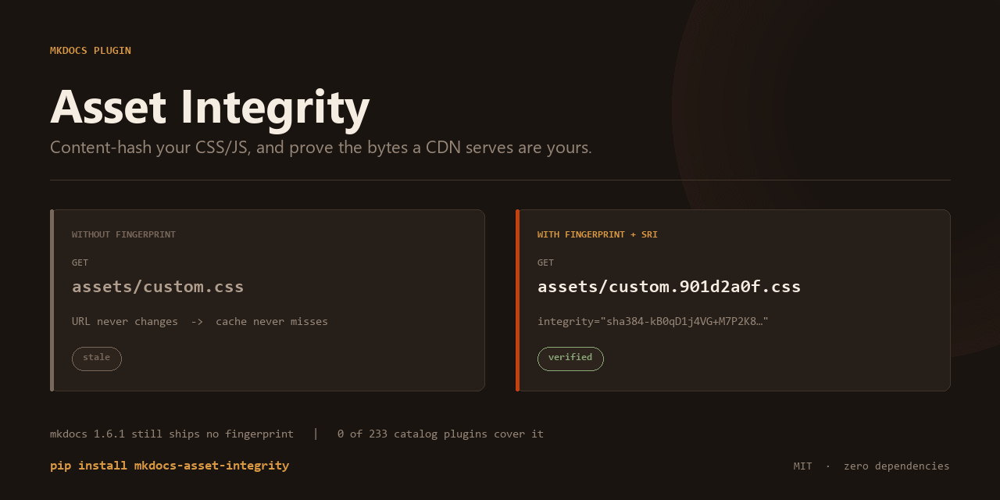

# mkdocs-asset-integrity



**Content-hash your MkDocs CSS/JS, and add Subresource Integrity so a CDN cannot serve tampered bytes.**

MkDocs gives every asset you declare the same filename forever. Change
`assets/custom.css` on Monday, deploy, and visitors whose browsers cached it
last week keep the old copy — content updates, styling does not. Upstream has
tracked this since 2020 ([mkdocs#1979](https://github.com/mkdocs/mkdocs/issues/1979),
34 comments) and the fix ([mkdocs#3018](https://github.com/mkdocs/mkdocs/pull/3018))
is still an open pull request.

The usual workaround, `mkdocs-minify-plugin` with `cache_safe: true`, only
touches files you enumerate one by one in `css_files` / `js_files` — both
default to `None`, so it silently does nothing until you duplicate your asset
list — and it never emits `integrity` attributes at all.

This plugin does both, in one place:

```yaml
plugins:
  - asset-integrity
```

Before:

```html
<link rel="stylesheet" href="assets/custom.css">
<script src="assets/app.js"></script>
```

After:

```html
<link rel="stylesheet" href="assets/custom.901d2a0f.css"
      integrity="sha384-kB0qD1j4VG+M7P2K8r2ywD9IAzKKvvxMonSbUrJxGrPeBmlGPxKQNPtuA4nhcApR"
      crossorigin="anonymous">
<script src="assets/app.dd54f36f.js"
        integrity="sha384-3VTzb8WlgEmVEI58DWS7DNZBRjYzmLqcBZypc2MaAce3ge/E2kAfQ1m9W20wwdtp"
        crossorigin="anonymous"></script>
```

## Install

```bash
pip install mkdocs-asset-integrity
```

Requires MkDocs 1.4+. No other dependencies.

## What it handles

| Situation | Behaviour |
| --- | --- |
| `extra_css` / `extra_javascript` | Fingerprinted and given SRI |
| Assets in subdirectories | Relative paths recomputed per page depth |
| `@import` chains between stylesheets | Repaired in dependency order, **before** hashing |
| Circular `@import` | Warns, breaks the cycle, still builds |
| A file whose name already has a hash | Left alone (no double-hashing) |
| External/CDN URLs | Untouched, never given SRI |
| Theme-provided assets | SRI only, not renamed (see [Limits](docs/limits.md)) |
| Asset declared but missing | Warning naming the exact path |
| `mkdocs-minify-plugin` in the same build | Conflict detected and explained |
| Non-UTF-8 stylesheet | Skipped safely, reported |

## Configuration

Every option is optional; the defaults are what most sites want.

```yaml
plugins:
  - asset-integrity:
      enabled: true                  # master switch
      algorithm: sha384              # sha256 | sha384 | sha512
      cache_busting: true            # rename files to include a content hash
      subresource_integrity: true    # emit integrity= and crossorigin=
      hash_length: 8                 # hex chars in the filename
      include_theme_assets: false    # also rename theme assets (see Limits)
      extra_assets: []               # extra paths to fingerprint
      exclude: []                    # fnmatch globs to leave alone
      report: false                  # log a one-line summary per build
      fail_on_error: false           # escalate per-asset errors to build errors
```

## Verify it worked

The hash in the filename should change whenever the file's bytes change, and
stay the same when they do not:

```bash
mkdocs build
grep -o 'custom\.[0-9a-f]\{8\}\.css' site/index.html
# edit docs/assets/custom.css, rebuild, run again -> different hash
```

To confirm the `integrity` values really describe the served bytes, this
recomputes them independently:

```python
import base64, hashlib, re, pathlib
site = pathlib.Path("site")
html = (site / "index.html").read_text(encoding="utf-8")
for url, sri in re.findall(r'(?:href|src)="([^"]+\.(?:css|js))"[^>]*integrity="([^"]+)"', html):
    algo, expected = sri.split("-", 1)
    actual = base64.b64encode(hashlib.new(algo, (site / url).read_bytes()).digest()).decode()
    print("OK " if actual == expected else "BAD", url)
```

## What it deliberately does not do

- **It does not fingerprint `search_index.json`.** The theme fetches that path
  from a string baked into its JS bundle; renaming it breaks search with no
  build-time error. This is a real gap and it is not solved here.
- **It does not rename fonts or images.** Their URLs live inside CSS `url()`
  and hand-written Markdown, where a rewrite would break links more often
  than it fixed them.
- **It does not fingerprint theme assets by default.** Material already ships
  `main.342714a4.min.css`; hashing that again produces a double hash, and some
  theme bundles load chunks by name at runtime.

Details and the reasoning behind each: [docs/limits.md](docs/limits.md).

## Development

```bash
pip install -e ".[test]"
pytest -q            # 91 tests: unit, end-to-end, and interop
mkdocs serve         # this documentation site, which uses the plugin
```

## License

MIT. See [LICENSE](LICENSE).
